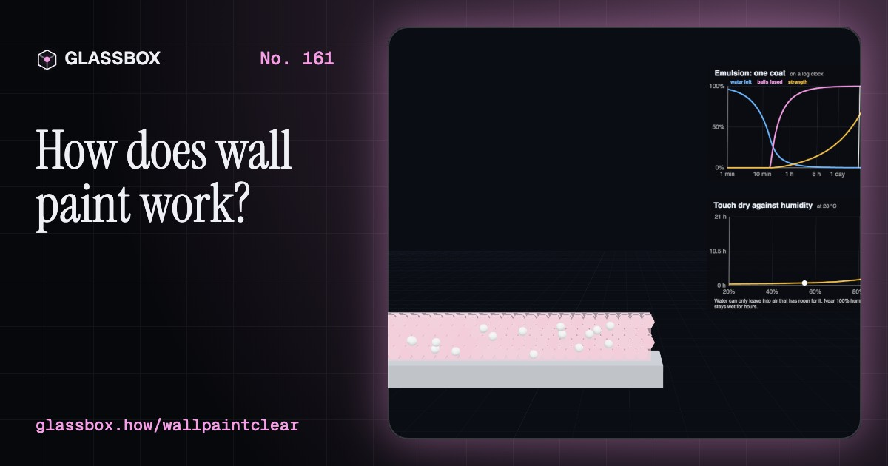
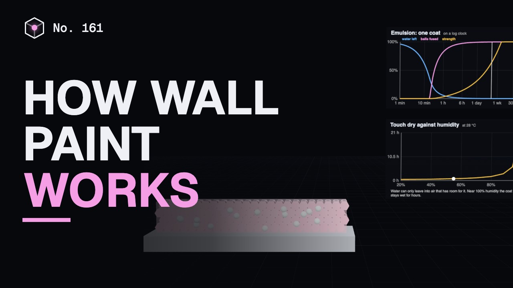
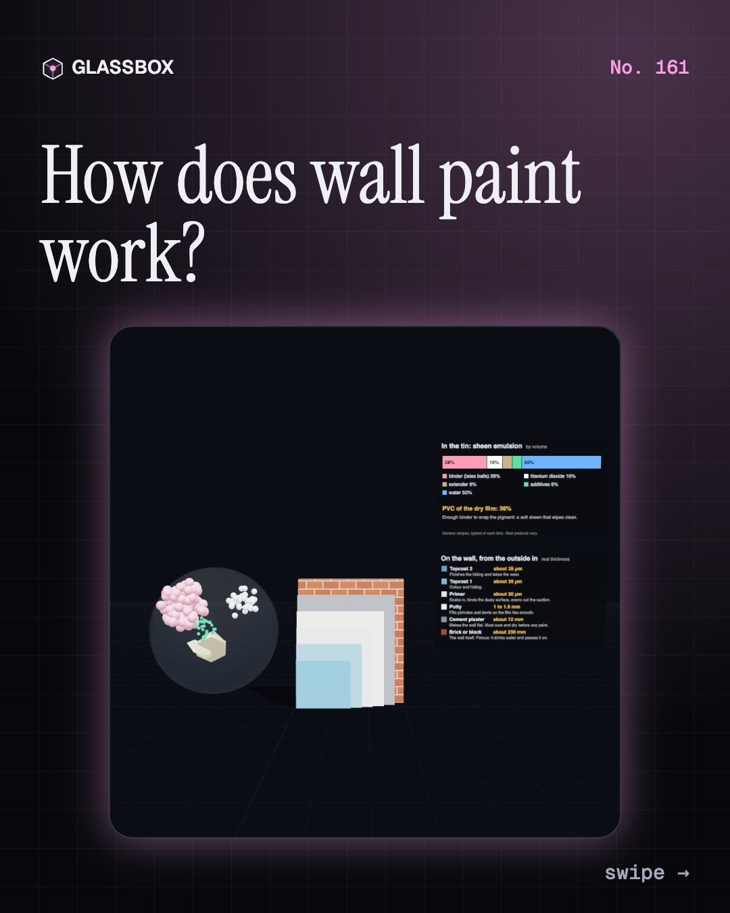
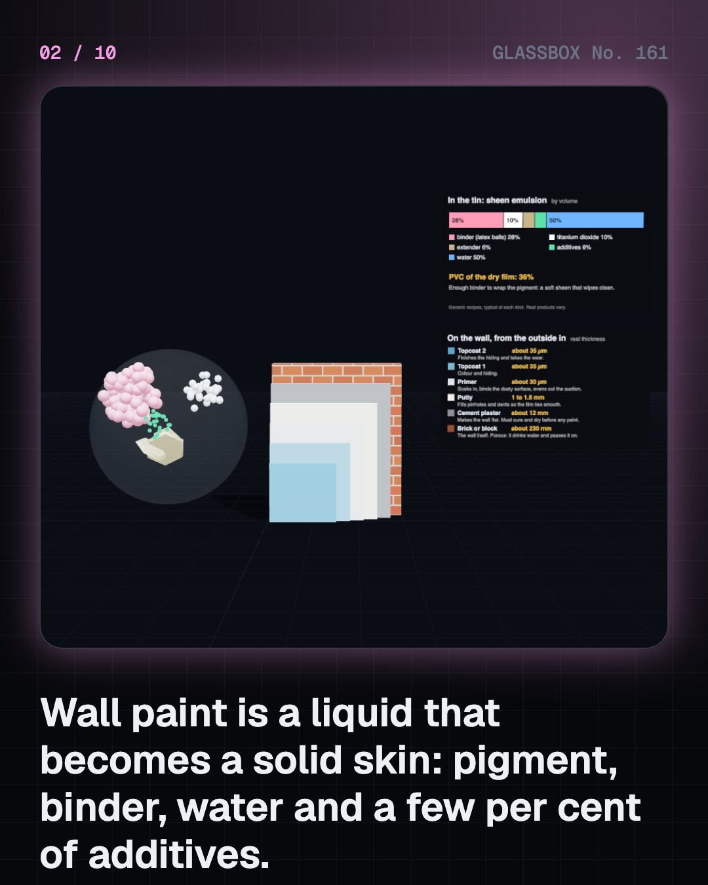
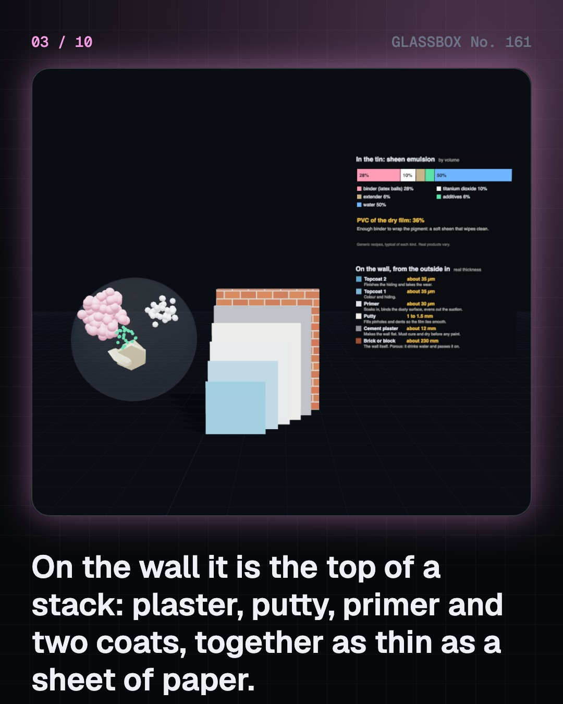
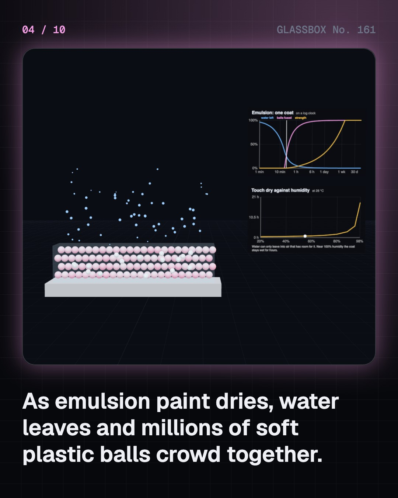

<!-- glassbox:start -->
<!-- Generated from glassbox.json by the Glassbox hub (npm run readme -- wallpaintclear). Edit glassbox.json, not this block. -->
<p align="center"><a href="https://glassbox.how/e/wallpaintclear/"></a></p>

<h1 align="center">WallPaintClear</h1>

<p align="center"><b>How does wall paint work?</b><br>A coat of wall paint is thinner than a hair, yet it hides a black wall. Watch millions of soft plastic balls squash into one film, follow photons lost in a maze of titanium dioxide, tint a white base, and find out why damp walls blister.</p>

<p align="center"><a href="https://glassbox.how/wallpaintclear/"><b>▶ Play with it</b></a> &nbsp;·&nbsp; <a href="https://glassbox.how/e/wallpaintclear/">Read the 60-second explainer</a> &nbsp;·&nbsp; <a href="https://glassbox.how/wallpaintclear/glassbox/reel.mp4">Watch the 40-second video</a></p>

<p align="center">
  <a href="https://glassbox.how/e/wallpaintclear/"></a>
  <a href="https://glassbox.how/e/wallpaintclear/"></a>
  <a href="LICENSE"></a>
  <a href="LICENSE-CONTENT.md"></a>
  <a href="#privacy"></a>
</p>

## In 60 seconds

1. **A liquid that becomes a skin.** Paint is four things: pigment (the powder you see), binder (the glue that becomes the film), a carrier that leaves (water or solvent) and a few per cent of additives. In an emulsion the binder is millions of soft polymer balls, 0.1 to 0.5 micrometres wide, afloat in water. On the wall, plaster, putty, primer and two topcoats make a stack; all the paint together is about a tenth of a millimetre thick.
2. **Drying is three steps, not one.** Water evaporates and the balls crowd until they touch. The last water presses them into a honeycomb, but only if the wall is warmer than the paint's minimum film-forming temperature. Then polymer chains wander across the old boundaries and the honeycomb becomes one film: touch dry within the hour, fully hard in a week or two. Oil enamel instead hardens when oxygen cross-links it, and limewash by taking carbon dioxide from the air and turning back into limestone.
3. **White hides by scattering.** White pigment absorbs almost nothing. Light bounces wherever the refractive index jumps, and titanium dioxide at about 2.7 against binder at 1.5 is the biggest jump of any common white pigment. A photon is knocked from grain to grain and usually stumbles back out before it reaches the wall. Chalk, at 1.6, almost vanishes in binder. The best grain size is about half the wavelength of light, 0.2 to 0.3 micrometres.
4. **Colour subtracts, roughness dulls.** Coloured pigments take wavelengths away: iron oxides soak up blue, phthalocyanine blue soaks up red, carbon black takes everything. A shop's tinting machine doses a few millilitres of strong colourants into a white base. Sheen is set by the surface: plenty of binder gives a smooth, glossy, washable film; a film crowded with powder is rough and matt, and hides the bumps in a wall.
5. **Thick, thin, thick again.** Paint is shear-thinning: about 80 Pa·s at rest, so pigment barely sinks, and hundreds of times thinner under the brush. It then takes a few seconds to thicken again, which is when surface tension flattens the brush marks. Coverage is a sum: square metres per litre = 10 × volume solids (%) ÷ dry film thickness (µm), so 38% solids at 30 µm covers about 12.7 m² a coat.
6. **Most failures are water, and the label matters.** Blisters and peeling are water trapped behind a film that cannot pass it; the white bloom on monsoon walls is salt left by evaporating water; algae needs a surface that stays damp. Fix the damp before repainting. In India, household and decorative paint may not hold more than 90 parts per million of lead (rules notified in 2016, in force since 1 November 2017). The World Health Organization says there is no known safe level of lead in blood.

## Words worth knowing

| Term | Meaning |
|---|---|
| **Pigment** | Fine solid powder that gives paint its colour and hiding power; it does not dissolve. |
| **Binder** | The film-forming part of paint that glues the pigment to the wall: acrylic latex, alkyd resin, oil, lime or glue. |
| **Latex** | Tiny balls of polymer floating in water, 0.1 to 0.5 micrometres wide, which fuse into a film as the water leaves. |
| **Coalescence** | Separate polymer balls squashing together and fusing into one continuous film as their chains mix across the boundaries. |
| **Minimum film-forming temperature (MFFT)** | The coldest wall on which a latex paint can still fuse into a film instead of a powder. |
| **Refractive index** | How much a material slows light. Light scatters where the index changes, and more for a bigger change. |
| **Pigment volume concentration (PVC)** | The pigment and extender as a share of the dry film by volume. Low PVC is glossy and tough, high PVC is matt and porous. |
| **Shear-thinning** | Getting thinner the faster it is stirred or brushed, and thick again at rest. |
| **Efflorescence** | White salt crystals left on a wall when water carrying dissolved salts evaporates at the surface. |

## A short history

**A hundred thousand years from ground ochre in a shell to a film of plastic and titanium white, and the long work of taking the lead out.**

- **100000 BCE** · A paint kit in a cave (Early Homo sapiens, Blombos Cave, South Africa)
- **10000 BCE** · Bhimbetka's painted shelters (Mesolithic and later artists, Bhimbetka, Madhya Pradesh, India)
- **470** · The Ajanta murals (Painters of the Vakataka period, Ajanta, Maharashtra, India)
- **1875** · Paint ready to use (Henry Sherwin and Edward Williams, Cleveland, Ohio, USA)
- **1902** · A paint works at Howrah (A. N. Turner and A. C. Wright, Howrah, West Bengal, India)
- **1909** · France bans white lead in buildings (French parliament, France)
- **1916** · Titanium white goes into production (Peder Farup and Gustav Jebsen; Titanium Pigment Company, Fredrikstad, Norway and Niagara Falls, USA)
- **1941** · Kem-Tone: paint thinned with water (Sherwin-Williams chemists, Cleveland, Ohio, USA)

The full story, with 30 moments, charts, people and 40 sources: [glassbox.how/e/wallpaintclear/history](https://glassbox.how/e/wallpaintclear/history/). The data lives in [`history.json`](history.json).

## Video and slides

Made with the Glassbox studio from this box's storyboard (`window.glassbox.director`). Free to reuse under CC BY 4.0.

<a href="https://glassbox.how/wallpaintclear/glassbox/video.mp4"></a>

<p><a href="glassbox/slide-1.jpg"></a> <a href="glassbox/slide-2.jpg"></a> <a href="glassbox/slide-3.jpg"></a> <a href="glassbox/slide-4.jpg"></a></p>

| File | What | Size |
|---|---|---|
| [`glassbox/reel.mp4`](https://glassbox.how/wallpaintclear/glassbox/reel.mp4) | Reel / Short, with captions and soundtrack | 1080×1920 |
| [`glassbox/video.mp4`](https://glassbox.how/wallpaintclear/glassbox/video.mp4) | YouTube video, with captions and soundtrack | 1920×1080 |
| `glassbox/slide-1…10.jpg` | Instagram carousel | 1080×1350 |
| `glassbox/thumb.jpg` | YouTube thumbnail | 1280×720 |
| `glassbox/cover.jpg` | Share card and repo social preview | 1200×630 |
| [`glassbox/history-reel.mp4`](https://glassbox.how/wallpaintclear/glassbox/history-reel.mp4) | “History in 10 moments” Reel / Short | 1080×1920 |
| `glassbox/history-slide-*.jpg` | History carousel | 1080×1350 |
| `glassbox/post.json` | Post copy and schedule used by the publish kit | |

## Privacy

This box has no accounts and no ads, and it ships its own fonts and libraries. When you run it yourself it sends nothing anywhere. On glassbox.how, the site's `/bar.js` also loads Glassbox's analytics: **Google Analytics** to count visits (it asks first in the EU, UK and Switzerland, and stays off when your browser sends Global Privacy Control or Do Not Track) and **ClickTrust** to detect bots.

It remembers a few things **in your own browser only**, and never sends them anywhere:

| Browser storage key | What it holds |
|---|---|
| `wallpaintclear.v1` | Which chapters you have opened, your best quiz scores, and sound on or off. |

Exactly what each one sees is at [glassbox.how/privacy](https://glassbox.how/privacy/).

## Licences

- **Code:** [MIT](LICENSE). Use it, change it, ship it.
- **Explanations, text, images and videos** (`glassbox.json`, `glassbox/`): [CC BY 4.0](LICENSE-CONTENT.md). Credit “Glassbox, glassbox.how/e/wallpaintclear”.
- **Third-party parts** keep their own licences: [three.js](https://threejs.org) (MIT), [Geist, Instrument Serif](https://openfontlicense.org) (SIL OFL 1.1).
- The Glassbox name and logo aren't covered by either licence. See the [terms](https://glassbox.how/terms/).

Found a mistake? [Open an issue](https://github.com/bdeeps/wallpaintclear/issues). Corrections happen in public.
<!-- glassbox:end -->

## Run it

It's plain HTML, CSS and JavaScript. No build step and no dependencies. Run locally, it contacts no other website.

```bash
python3 -m http.server 8000
```

Three.js and the fonts ship in `vendor/` and `fonts/`, so it also works offline.

Then open http://localhost:8000.

## How it's built

| File | What |
|---|---|
| `index.html`, `css/app.css` | The page and its styles |
| `js/app.js`, `js/stage.js`, `js/ui.js`, `js/kit.js` | The shared Glassbox 3D engine: chapters, 3D stage, controls, quiz, video director |
| `js/paint.js` | Shared models for this box: film drying, Kubelka–Munk hiding, colour, flow, damp, and the chart boards |
| `js/chapters/*.js` | One file per chapter: the 3D model, controls, text, key terms, quiz and video scenes |
| `glassbox.json` | Title, question, explainer beats, key terms, browser storage and credits shown on glassbox.how |
| `reel` in each chapter | The storyboard the Glassbox studio records into short videos |
| `glassbox/` | The published video, slides, thumbnail and post copy |
| `fonts/`, `vendor/three/` | Self-hosted Geist and Instrument Serif (SIL OFL 1.1) and three.js (MIT) |
